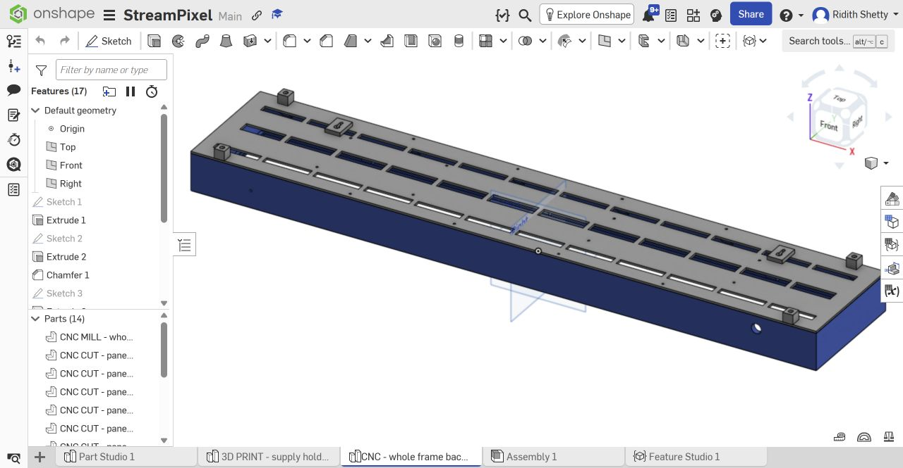
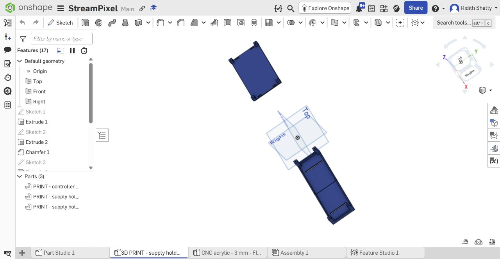
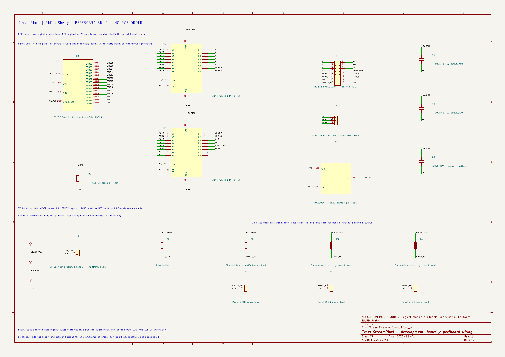
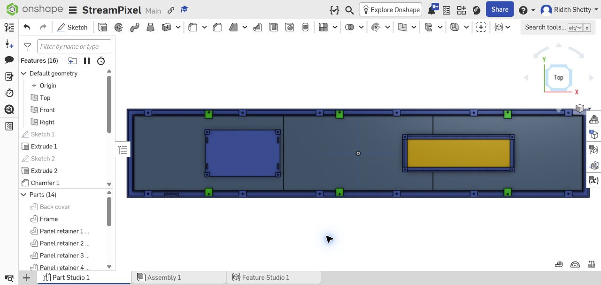

# StreamPixel

StreamPixel is Ridith Shetty's three-panel RGB display project, using an ESP32 development board, perfboard, two 5V logic buffers and a MAX9814 microphone. Three nominal 320 × 160 mm P10 panels form a 960 × 160 mm display with 96 × 16 pixels. Local phone/browser controls provide scrolling text, colour animation/test and relative microphone activity.

**This is a design and prototype handoff, not a claim of assembled, tested hardware. No custom PCB order is required.**

The reference-layout image shows placeholder panel thickness and supply dimensions. It is not a photo or a physical fit test.

## Files to use

- [CAD](CAD/): genuine editable FreeCAD source, STEP geometry, native Onshape FeatureScript source and the manufacturing handoff. The source is `.FCStd` plus STEP; these are not renamed Fusion `.f3d` files.
- [CNC parts](CAD/CNC/): **one whole frame, one whole backplate, six panel retainers, four wall spacers and two hanger pads**. Use the 3D STEP files for milling; DXFs describe only their indicated flat profiles.
- [3D-printed holders](CAD/3D_PRINTED/): **controller tray and two supply-holder halves only**. Print one of each STL. The supply holder is for the power supply, not a battery.
- [Perfboard schematic](PCB/StreamPixel-perfboard.kicad_sch), [KiCad project](PCB/StreamPixel-perfboard.kicad_pro) and [PDF](PCB/StreamPixel-perfboard.pdf). Keep the adjacent symbol library and `sym-lib-table` with the project. The `PCB` folder contains wiring documentation, not a PCB manufacturing order.
- [Firmware](FIRMWARE/README.md): ESP32 source, setup instructions and successful compile log. Actual display/microphone operation remains untested.
- [BOM with recorded prices and vendor links](BOM.csv).
- [Half Life journal](JOURNAL.md), mirrored from the project platform.

Native Onshape studios: [CNC frame, backplate and fittings](https://cad.onshape.com/documents/ff33f56b02d9867b20260f9d/w/d771c62f16da9b74f071b096/e/97cd61c99cbb00f7ac08fe59) and [3D-printed holders only](https://cad.onshape.com/documents/ff33f56b02d9867b20260f9d/w/d771c62f16da9b74f071b096/e/aeadc6d027d2d7d05235b7d8).

## Mechanical handoff

The whole frame is **990 × 190 × 60 mm**, with a **958 × 158 mm** front aperture and **962 × 162 mm** locating pocket. The rear plate is **990 × 190 × 3 mm**. Spacers extend the total front-to-wall depth to **78 mm**. StreamPixel and Ridith Shetty are recessed in the front border.

The deep frame is a **3D CNC milling job**, not a flat-sheet DXF cut. The shop must review stock, cutter access, internal corners, nut pockets, workholding, setups, material suitability and cost. No machine-specific CAM or G-code is supplied. Screws, nuts and wall anchors are purchased hardware, not CNC-cut acrylic parts.

Panel body thickness remains a **15 mm placeholder**; the supply reference remains an **unverified 220 × 60 × 25 mm envelope**. Actual connector/terminal space, gland grip, panel tolerances, screw reach, wall loads and temperature need verification before manufacture. A CAD overlap check cannot establish physical fit or structural capacity.

Hardware plan: **22 M3x10, four M3x25 and four M3x16 bolts; 30 M3 nuts**, plus suitable washers and wall anchors. Check actual fasteners and acrylic clamping before ordering.

## Wiring and software

Follow [the GPIO wiring guide](PCB/WIRING.md). The schematic uses logical printed labels for the development board and microphone; it does not guess their physical header positions. HCT buffer and proposed panel-connector pin numbers are shown explicitly. Three separately protected branches feed the panels, with a separate controller branch and common ground. MAX9814 uses 3.3V and GPIO34 (ADC1).

The active schematic passed KiCad ERC with **0 errors and 0 warnings**; its exported connectivity was checked against the selected GPIO mapping. Firmware compiled for **esp32:esp32:esp32**, using ESP32 core **3.3.11**, HUB75 library **3.0.14**, Adafruit GFX **1.12.6** and BusIO **1.17.4**. The build uses 963,684 bytes of flash and 48,672 bytes of global RAM. These are computer checks, not hardware test results.

Panel output is disabled by default until the actual scan ratio, driver, connector and row mapping are verified and configured. The normal HUB75 geometry is not an unidentified 1/4-scan P10 remap. First test one panel at low brightness, then configure the three-panel chain. Spotify integration is not implemented.

This is a plug-in 5V-supply build. Its holder is not a mains-rated enclosure. Suitable terminal guarding, earthing, strain relief and protected installation still need to be provided for the actual supply.

## Budget and work still required

Budget: **INR 6,445**. Carts checked on 1 November 2026: Koshi **INR 2,499**, Quartz **INR 1,526**, and Industrybuying **INR 578**, including its displayed INR 298 delivery. Total **INR 4,603**, leaving **INR 1,842** before remaining delivery and manufacturing. Quartz includes the MAX9814 microphone, 2m each of red/black power wire, 24 M3x10 bolts, four M3x25 bolts, four M3x15 bolts, 32 nuts, 24 washers and cable ties. The panel listing includes a power cable and FRC/data cable per module. Prices and availability remain subject to checkout; nothing has been purchased.

Still unquoted: the whole CNC frame and other CNC parts, three printed holder pieces, wall anchors, final supply-terminal protection/installation, any routing-dependent extra terminals/wires and remaining delivery. Tools are outside the parts carts. The final build is **not confirmed within INR 6,445**; obtain the CNC quote before ordering. The four M3x15 cart bolts are substitutes for the nominal M3x16 hanger-pad bolts: check the physical washer/plate/pad stack and full nut engagement before fitting. The 8mm-OD washers must not be inserted in the 7mm wall-foot head recesses.

Before making or demonstrating it:

1. Obtain the actual panel and supply measurements and update the model where needed.
2. Have the CNC shop approve machining details and quote the complete job; get a print quote for the holders.
3. Test fastener/joint fit and verify the mounting arrangement with the actual weight and wall.
4. Check unpowered continuity, power polarity, protection and actual module/panel pinouts.
5. Configure and test one panel, then three; measure current and enclosed temperatures.
6. Record real assembled photos and an honest working/failure demo. No physical result or manufacturing approval is claimed here.
