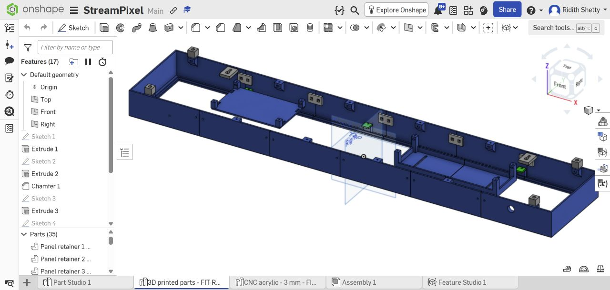
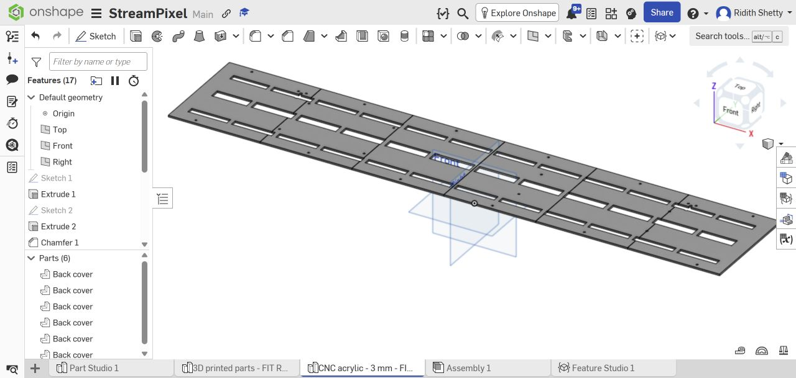
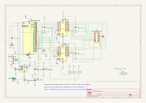
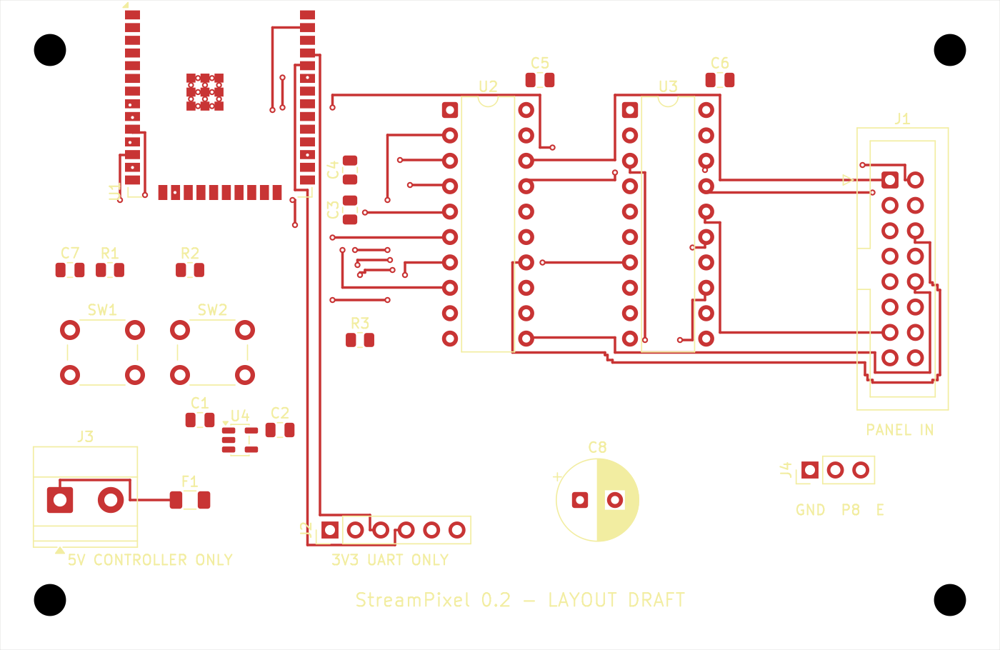

# StreamPixel

StreamPixel is Ridith Shetty's three-panel RGB display project. The proposed build combines three P10 panels, an ESP32 controller, 5V logic buffers and a microphone for sound-reactive display effects. The nominal display is 96 × 16 pixels across a 960 × 160 mm panel array.

**Current status: design and fit review. No assembled or working hardware demo is claimed.** The CAD now includes a ventilated rear cover, six removable panel retainers, controller tray, supply cradle, wall spacers, splice plates, cable exit and engraved project/creator names. Real panel and supply measurements, printing, electrical installation and firmware testing remain outstanding.

These four images show CAD and electronics design work. They are not evidence of assembled or tested hardware. The PCB is still in development.

## Open the design

- [Editable Onshape document](https://cad.onshape.com/documents/ff33f56b02d9867b20260f9d/w/d771c62f16da9b74f071b096/e/aeadc6d027d2d7d05235b7d8): print preparation with native feature history.
- `cad/exports/`: current STEP geometry for editing in CAD software.
- `cad/source/`: FeatureScript source used in the Onshape document, alongside editable FreeCAD solid review models. FeatureScript alone is not a replacement for the STEP/native CAD source.
- `cad/print/`: 35 individual fit-review STLs, each moved to its own local origin with its minimum Z at zero. Select a suitable print orientation in your slicer.
- `cad/cnc/`: six individual 1:1 millimetre acrylic DXFs and a combined 515 × 390 mm layout. Read the cutting notes before ordering.
- [CNC acrylic Onshape studio](https://cad.onshape.com/documents/ff33f56b02d9867b20260f9d/w/d771c62f16da9b74f071b096/e/97cd61c99cbb00f7ac08fe59): six separate 165 × 190 × 3 mm panels.
- `electronics/source/`: KiCad schematic, board and project. The custom board is unfinished and must not be ordered.
- `docs/PROTOTYPE-WIRING.md`: the separate ESP32 development-board/perfboard wiring route used for the budget plan.
- [Bill of materials with prices and vendor links](bom.csv): priced prototype parts and historical delivery provisions; see [budget review](purchasing/BUDGET.md) and [unquoted requirements](purchasing/UNQUOTED-REQUIREMENTS.csv) for missing costs.
- `firmware/STATUS.md`: firmware work still required. No tested firmware is included yet.
- `archive/concept-cad/`: earlier concept exports retained for history. Do not mix these with the current Onshape export.

## Dimensions and limitations

The main frame is 990 × 190 × 60 mm. The cover and rear spacers extend total front-to-wall depth to 78 mm. The front aperture is 958 × 158 mm and the locating pocket is 962 × 162 mm. Frame walls are 3 mm. The manufacturing model has 35 printed pieces and six CNC acrylic panels, separated into their own Onshape Part Studios, with XY footprints checked against an assumed 220 × 220 mm print bed.

The panel body thickness is a **15 mm placeholder**. The supply is represented by an **unverified 220 × 60 × 25 mm envelope**. Panel connector positions, gland mounting diameter, actual screw/nut fit, wall-anchor suitability, wiring space, temperature and load capacity need verification. A zero-overlap CAD result only checks the modeled geometry.

## Build route and power

Use the development-board/perfboard route for the current cost plan; do not also buy the custom bare-module controller BOM. Three separately protected 5V branches feed the panels. The controller has its own branch and shares signal ground. Two HCT245 buffers translate ESP32 signals to 5V panel logic. Follow the GPIO wiring guide and confirm the actual panel connector before powering it.

This is a plug-in supply design; no battery is included. The printed cradle does not provide a certified mains enclosure. Terminal protection, earthing, strain relief and installation must be suitable for the actual supply and checked before use.

## What remains

Follow [the complete checklist](docs/FINISH-CHECKLIST.md). Main blockers are measured component fit, a print quote within the INR 5,500 budget, physical joint/load tests, final protected power installation and tested firmware. The saved custom-PCB report has 65 unconnected items; its geometric-clearance result alone is not fabrication approval.

The existing journal remains unchanged. This technical README and packaging work were prepared with AI assistance and do not establish compliance with a program's authorship or submission rules. Record actual personal design work, logged sessions, test results and demo footage accurately.
